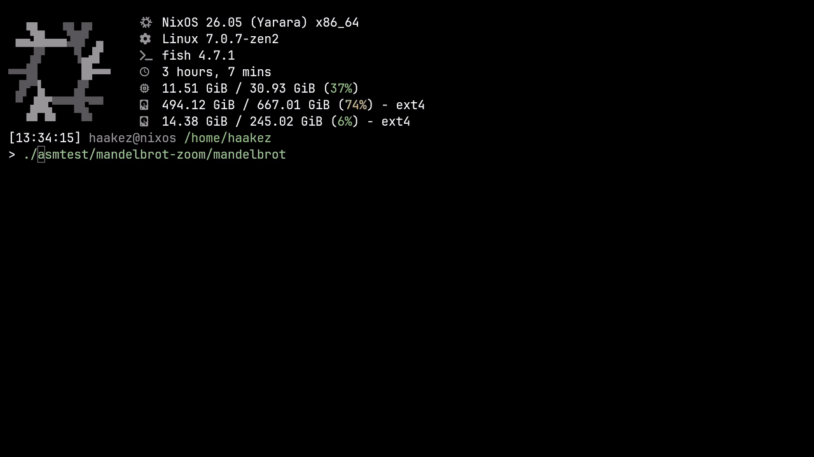

## cli mandelbrot renderer


## build and run

requires linux x86-64, gcc and mpfr

```sh
gcc -O2 -no-pie mandelbrot.s -lmpfr -o mandelbrot
./mandelbrot
```

## run with nix

requires the nix package manager

```sh
nix run github:haaakez/cli-mandelbrot
```
